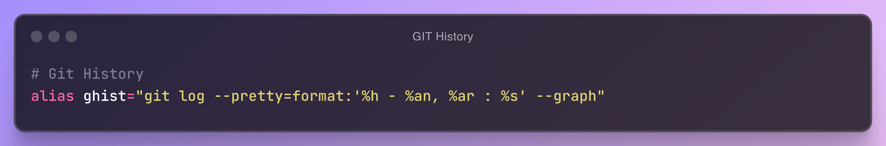
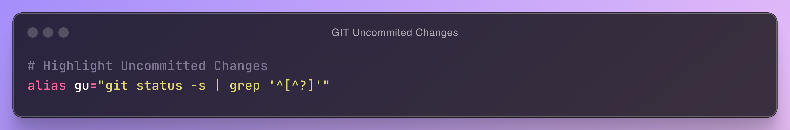
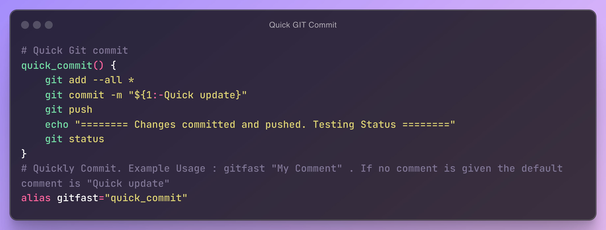
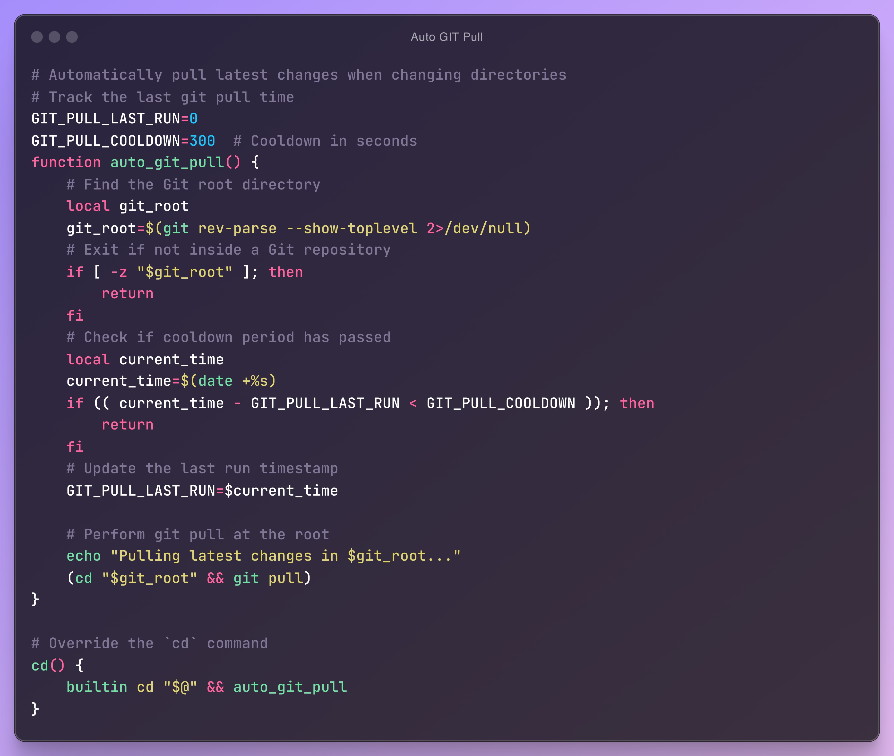
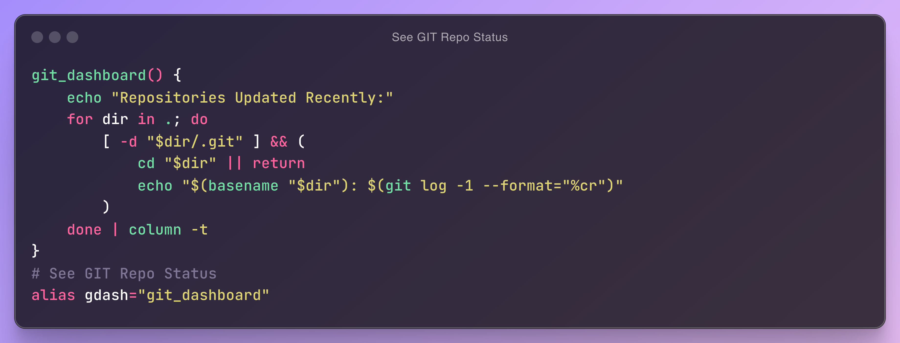
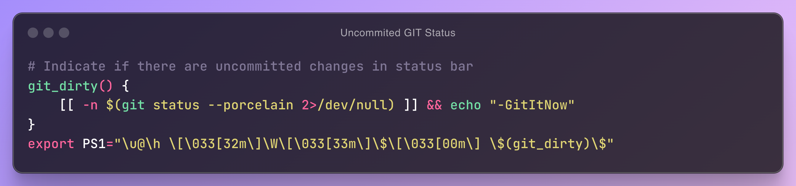
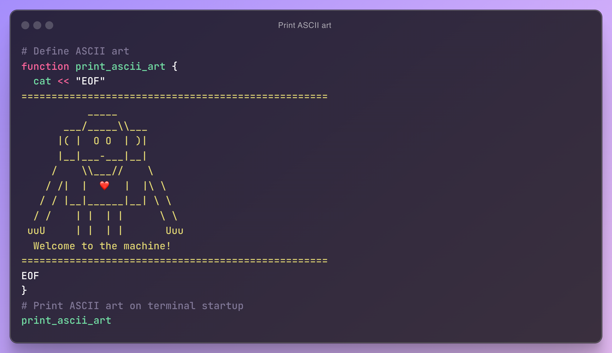
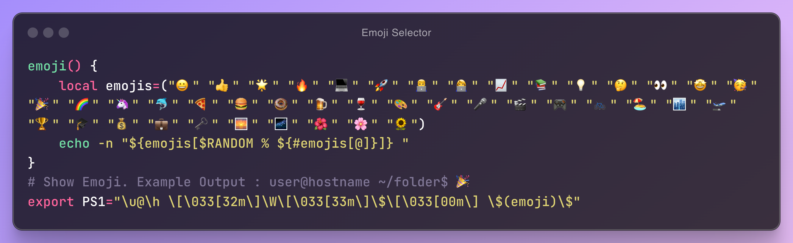
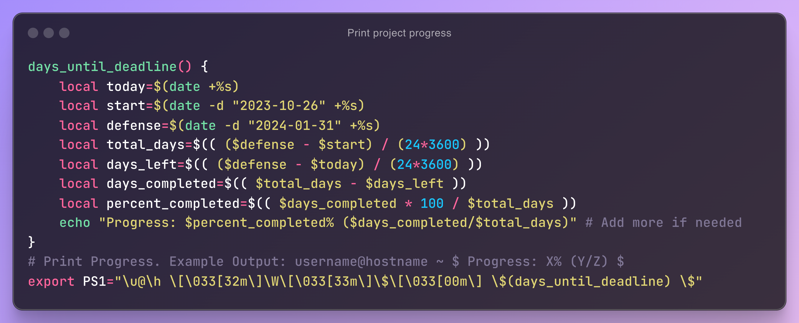
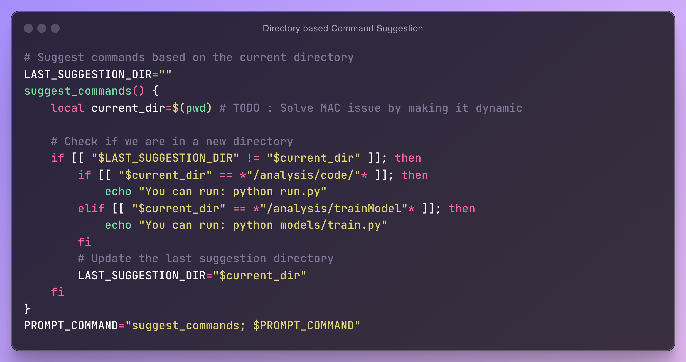

# ⭐️ Star This Repository & Follow Me on GitHub!
If you find this repository useful, please consider giving it a star ⭐️ to show your support **(This Repo will keep getting updated)**. Don't forget to follow me on GitHub for more awesome content and updates! Every star inspires me to create even more powerful tools. 💻✨

# Git Related
## 1. **Beautiful Git History View**. [ [Copy Code](code/GIT-History.sh)]  
   Creates a `ghist` alias for a compact, visually enhanced Git log. Displays commits as a graph with abbreviated hash, author, relative time, and message.

## 2. **Highlight Uncommitted Git Changes**. [ [Copy Code](code/GIT-Uncommited-Changes.sh)]  
   Adds a `gu` alias to display uncommitted changes in a Git repository, filtering out untracked files for a cleaner status view.

## 3. **Quick Git Commit and Push**. [ [Copy Code](code/Quick-GIT-Commit.sh)]  
   Defines a `quick_commit` function for fast Git operations. Stages all changes, commits with a custom or default message ("Quick update"), and pushes to the repository. An alias gitfast simplifies usage for rapid commits and testing. Example: gitfast "My comment".

## 4. **Auto-pull GIT on `cd` into a repo (with cooldown)**. [ [Copy Code](code/Auto-GIT-Pull.sh)]  
   This script overrides `cd` to automatically run `git pull` in Git repositories, with a cooldown (`GIT_PULL_COOLDOWN`) to limit frequency. It detects Git repos, tracks the last pull time (`GIT_PULL_LAST_RUN`), and ensures seamless updates during directory changes.

## 5. **Git Repository Dashboard**. [ [Copy Code](code/See-GIT-Repo-Status.sh)]  
   Defines a git_dashboard function to display the last update time for Git repositories in the current directory. Lists repositories with their most recent commit timestamps in a tabular format. The alias `gdash` provides a quick way to run this dashboard.

## 6. **Git Dirty Status Indicator**. [ [Copy Code](code/Uncommited-GIT-Status.sh)]  
   Adds a git_dirty function to display -GitItNow in the shell prompt (PS1) when there are uncommitted changes in the current Git repository, helping to keep track of pending work.

# Fun Ones
## 1. **ASCII Art Welcome Message**.[ [Copy Code](code/Print-ASCII-art.sh)]  
   Defines and displays an ASCII art welcome message on terminal startup. The print_ascii_art function prints a stylized graphic and a greeting to enhance the user experience.
## 2. **Dynamic Emoji in Shell Prompt**.[ [Copy Code](code/Emoji-Selector.sh)]  
   This script adds a dynamic emoji to the shell prompt (`PS1`) by randomly selecting from a predefined list of emojis each time the prompt is displayed. It enhances the visual appeal and injects fun into the terminal experience.
## 3. **Deadline Progress Tracker**.[ [Copy Code](code/Print-project-progress.sh)]  
   Defines a `days_until_deadline function` to calculate and display progress toward a set deadline. It shows the percentage of time completed and the days elapsed/remaining. Integrates with the shell prompt (PS1) to provide real-time updates.
## 4. **Directory context-based Command Suggestions**. [ [Copy Code](code/Directory-based-Command-Suggestion.sh)]  
   This script suggests context-specific commands based on the current directory. It detects changes in the working directory and, for predefined paths (e.g., `/analysis/code/` or `/analysis/trainModel`), displays relevant commands. The `PROMPT_COMMAND` ensures suggestions run automatically with each prompt refresh.